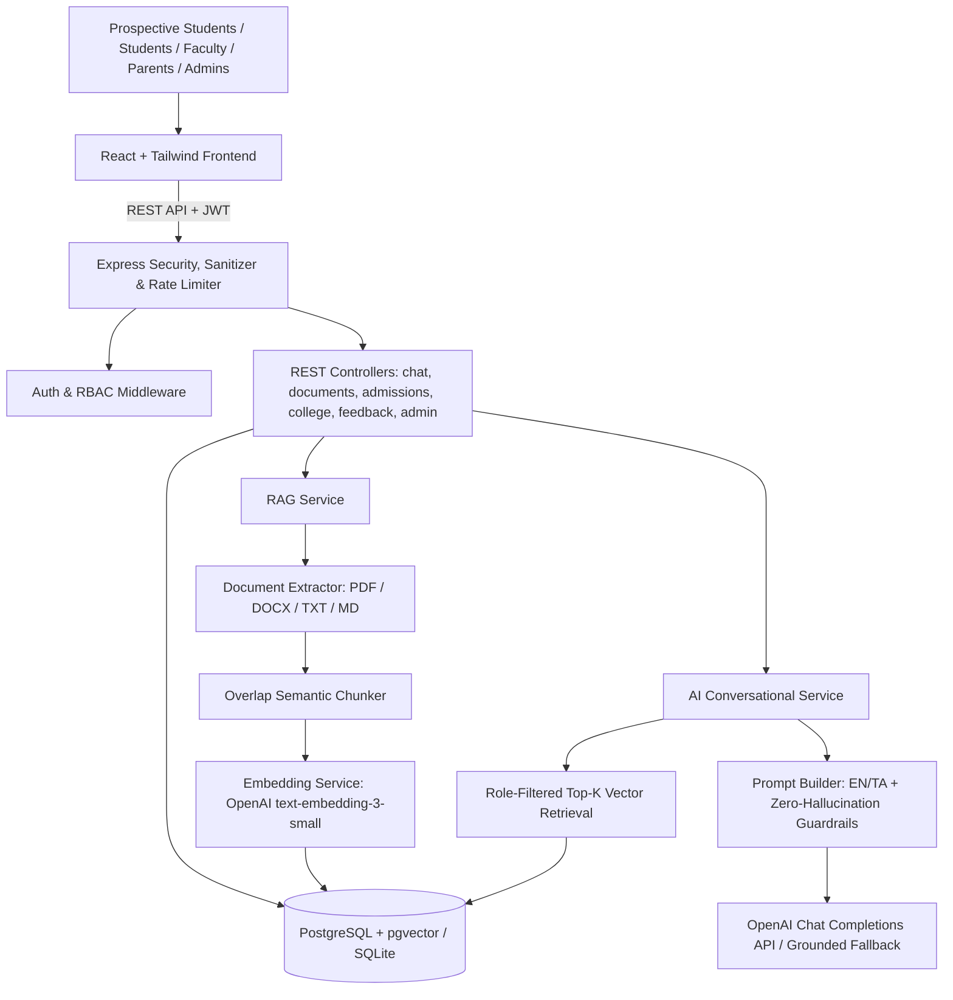
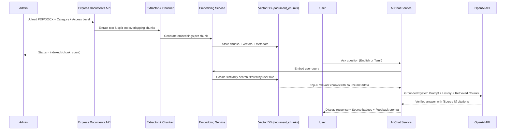

# NSCET AI College Assistant — System Architecture

## 1. High-Level System Architecture

```text
+-----------------------------------------------------------------------+
|                       USER INTERFACE (Browser)                        |
|      React.js + Tailwind CSS (Blue / White / Gold Academic Theme)     |
|  [AI Chat] [College] [Admissions] [Departments] [Academics] [Admin]   |
+-----------------------------------+-----------------------------------+
                                    | HTTPS / REST JSON + JWT Bearer
                                    v
+-----------------------------------------------------------------------+
|                 BACKEND API (Node.js / Express.js)                    |
|  Security Headers | XSS Sanitizer | Rate Limiter | Audit Logger       |
+-----------------+----------------------------------+------------------+
                  |                                  |
                  v                                  v
+---------------------------------+   +---------------------------------+
|  AUTHENTICATION & RBAC LAYER    |   |        AI & RAG ENGINE          |
|  - JWT (bcryptjs + HS256)       |   |  1. Language (EN / TA) & Intent |
|  - Roles: admin, faculty,       |   |  2. RBAC-Filtered Vector Search |
|           student, guest        |   |  3. Grounded System Prompt      |
|  - Document Access Matrix       |   |  4. OpenAI API / Local Fallback |
+-----------------+---------------+   +----------------+----------------+
                  |                                    |
                  |                   +----------------+----------------+
                  |                   |          RAG PIPELINE           |
                  |                   |  PDF/DOCX/TXT -> Extract Text   |
                  |                   |  -> Semantic Chunker (Overlap)  |
                  |                   |  -> OpenAI / Local Embeddings   |
                  |                   +----------------+----------------+
                  v                                    v
+-----------------------------------------------------------------------+
|               DATA & VECTOR PERSISTENCE LAYER                         |
|  Production : PostgreSQL 15+ with pgvector (HNSW vector_cosine_ops)   |
|  Local Dev  : Built-in Node SQLite + Hybrid Cosine Similarity Engine  |
|  12 Tables  : roles, users, conversations, messages, documents,       |
|               document_chunks, admission_enquiries, feedback,         |
|               departments, faculty, placement_information, audit_logs |
+-----------------------------------------------------------------------+
```

## 2. Mermaid Architecture Diagram



## 3. Document Ingestion & RAG Query Flow



## 4. Role-Based Document Access Control Matrix

| User Role | `public` Docs | `student` Docs | `faculty` Docs | `admin` Docs | Admin Dashboard |
|---|:---:|:---:|:---:|:---:|:---:|
| **Guest / Visitor** | Yes | No | No | No | No |
| **Student** | Yes | Yes | No | No | No |
| **Faculty** | Yes | Yes | Yes | No | No |
| **Admin** | Yes | Yes | Yes | Yes | Yes |

## 5. Database Entity-Relationship Summary (12 Tables)

1. **`roles`** — RBAC roles (`admin`, `faculty`, `student`, `guest`) and permissions JSON.
2. **`users`** — Portal accounts linked to `roles` and `departments`, storing `bcryptjs` password hashes.
3. **`departments`** — All 8 NSCET departments (CSE, AI&DS, IT, ECE, EEE, MECH, CIVIL, S&H).
4. **`faculty`** — Faculty directory linked to `departments`.
5. **`conversations`** — Chat threads associated with `users` or anonymous `session_token`, persona, and language.
6. **`messages`** — User & assistant turns with cited `sources`, `confidence_score`, `intent_category`, and `is_unanswered` flag.
7. **`documents`** — Uploaded college documents metadata, category, RBAC `access_level`, verification status, and processing state.
8. **`document_chunks`** — Chunked text segments with `vector(1536)` (`pgvector`) embeddings and HNSW index.
9. **`admission_enquiries`** — Prospective student admission leads with unique `reference_code` and CRM workflow status.
10. **`feedback`** — Helpful / Not helpful ratings and comments tied to `messages`.
11. **`placement_information`** — Training, internship, guidance, and verified official placement summaries.
12. **`audit_logs`** — Immutable trail of authentication, document, enquiry, and administrative actions.
